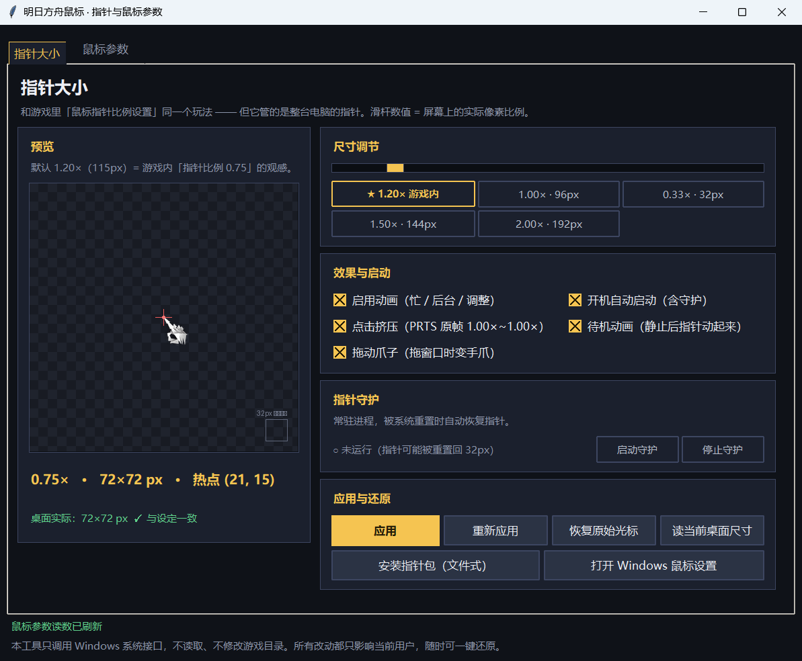

# 明日方舟 · 鼠标指针

把《明日方舟》那套**水晶指针**装进 Windows 桌面，并把 **PRTS** 工程的三项手感效果
（点击挤压 / 拖动爪子 / 待机动画）完整复刻过来。

不是皮肤包、不是壁纸 —— 它改的是**系统级光标**，在资源管理器、浏览器、任何程序里都生效。



---

## 它做什么

| 功能 | 说明 |
|---|---|
| **指针大小** | 滑杆实时调 32px ~ 192px，覆盖 17 个系统光标角色（箭头 / 文本 / 忙 / 十字 / 手型 …）。实测桌面真实像素并与设定比对，不一致会红字提醒 |
| **点击挤压** | 按下鼠标时指针轻轻挤一下。用的是 PRTS 的 `hand_<角色>` **107 帧原帧美术**，弹簧参数（520/30、子步 1/240、最短按下 75ms）逐字照抄，幅度约 ±5% |
| **拖动爪子** | 拖动窗口时指针变成爪子：张开 → 收拢 → 保持 → 松手收回，60fps 共 884ms |
| **待机动画** | 鼠标静置 5 秒后，指针播放 PRTS 的待机帧动画（进入段 30 帧 @60fps，循环段 342 帧 @15fps） |
| **指针守护** | 常驻进程。Windows 会在 explorer 重启、锁屏解锁、系统「鼠标设置」被打开等时机把光标重置回 32px 小指针，守护盯着并自动恢复 |
| **一键还原** | 写 `HKCU`，不需要管理员权限；「恢复原始光标」一键回到用之前的状态 |

三项手感效果来自 PRTS，实现细节、出处行号与验收记录见 **[手感效果说明.md](手感效果说明.md)**。

---

## 直接下载用（推荐）

1. 到 **[Releases](../../releases)** 页下载 `明日方舟鼠标_v1.0_portable.zip`
2. 解压到任意目录（**别放 C:\Program Files**，那里写不了配置）
3. 双击 `启动.bat`（或直接双击 `明日方舟鼠标.exe`）
4. 选尺寸 → 点「应用」→ 想要开机生效就勾上「开机自动启动（含守护）」

**要求**：Windows 10 / 11 64 位。
**不需要**装 Python，**不需要**管理员权限，**不联网**。

想卸载：程序里点「恢复原始光标」+ 取消「开机自动启动」，然后删掉文件夹。

---

## 从源码跑

```powershell
git clone https://github.com/DoingStone/Arknights-Mouse.git
cd Arknights-Mouse
python 源码\arkmouse\main.pyw
```

需要 Python 3.9+ 和 Pillow：

```powershell
pip install pillow
```

---

## 自己重建 exe

```powershell
pip install pyinstaller pillow
python 构建\build_exe.py
```

产物在 `构建\dist\`。脚本会把 `art.bin` 和 `fx.bin` 一起塞进 exe
（**漏掉 `fx.bin` 的话三项效果会静默全关**，见 `构建\build_exe.py` 的注释）。

打包免安装 zip：

```powershell
powershell -ExecutionPolicy Bypass -File 构建\make_release.ps1 -Version 1.0
```

---

## 工程结构

```
源码\arkmouse\          主程序
  main.pyw              GUI（Tkinter）+ CLI
  cursorwin.py          光标引擎：光栅化 / 尺寸阶梯 / 暗描边 / 动画状态机
  prtsfx.py             PRTS 三项效果（点击弹簧、拖动钩子、待机时序）
  guard.py              指针守护
  artpack.py            art.bin / fx.bin 的读取
  paths.py              打包版与源码版的路径解析
  store.py              设置读写
  art.bin               指针美术（17 个角色的帧数据）
  fx.bin                PRTS 效果美术（986 帧 / 12 族 / 6.97 MB）

指针\                   全部指针素材都在这一个目录里
  cursors\<档>\         可直接安装的指针文件（.cur/.ani × 4 档 × 17 角色）
  extracted\<档>\       每档的原生 PNG 预览图
  原始提取\              从游戏里导出的原始贴图与提取报告
  install.ps1           文件形式的安装器（只写 HKCU）
  README.md             指针包自己的说明
  提取来源说明.md        这些素材分别是从哪来的
提取工具\               从游戏与皮肤包里提取、重建指针资源
构建\                   build_exe.py / make_release.ps1
测试\                   各项验收脚本（离线逻辑 + 上屏端到端）
说明.md                 完整产品说明
手感效果说明.md          三项效果的技术细节与验收
```

---

## 一些实现上的取舍

- **为什么给指针建尺寸阶梯，而不是每次现缩**：`make_hcursor_pm` 实测 2.2–4.7 ms/档，
  17 个角色现造要 300–400 ms，远超 8 ms 的动画 tick。所以构建期铺好阶梯，
  运行期只做 `CopyIcon` + `SetSystemCursor`（0.2 ms）。
- **为什么用轮询读键态，而不是 `WH_MOUSE_LL` 全局钩子**：低级钩子会被系统按
  `LowLevelHooksTimeout` 静默摘掉，回调一旦漏掉 `WM_LBUTTONUP` 指针就永远停在缩小态。
  `GetAsyncKeyState` 读物理键态，没有「事件」可丢，"卡住"在结构上不存在。
  （唯一的例外是拖动检测 —— 那必须用 `SetWinEventHook`，所以动画线程里补了个消息泵。）
- **为什么预乘 alpha 自己算**：`premul_resize` 是「预乘 → LANCZOS → 反预乘」，
  跑了 1188 组与旧实现对照，逐字节相同；而 `Image.alpha_composite` / `ImageChops.multiply`
  版都不等价（视觉误差 9–15）。水晶指针的卖点就是边缘锐利，宁可慢一点。
- **暗描边**：深色背景下白色指针看不清，所以给浅色指针补一圈 1px 半透明描边。
  PRTS 的美术自带描边，本工程自动跳过（`needs_outline` 判定）。

---

## 已知限制

1. **三项效果需要常驻进程**（GUI 或 `--guard`）。关掉又不跑守护，效果就停了。
2. **`NWPen`（手写笔）角色恒为 16/17** —— Windows 没有给它对应的 `SetSystemCursor` 接口。
3. **爪子和待机固定在箭头（+ 移动）角色**，不像 PRTS 那样跟随当前角色。
4. **待机退出没有过渡帧**（PRTS 那两段是 `.ani` 多帧文件，没随美术导入）。
5. **游戏原版倍率缩放**（`click_style = "game"`）的两条缓动曲线不是游戏原值 ——
   `_onBtnDownAnim` / `_onBtnUpAnim` 的关键帧锁在一个 flag=4 的非标准压缩块里，
   已实测排除 LZ4 / LZMA2 / deflate / zlib / bz2 / brotli / LZO。详见 `手感效果说明.md` 附录 A。

---

## 版权与许可

**代码**（`源码\`、`构建\`、`提取工具\`、`测试\`）以 **MIT** 许可发布，见 [LICENSE](LICENSE)。

**美术资源不属于本工程原创**，不在 MIT 许可范围内：

- `指针\`、`源码\arkmouse\art.bin`、`源码\arkmouse\fx.bin`
  里的水晶指针美术来自第三方皮肤包 **PRTS Replica v8 96x**；
- 指针形象源自游戏 **《明日方舟》**（上海鹰角网络科技有限公司）。

本工程只做「把已有指针装进 Windows」这件事，**不声称对美术拥有任何权利**，
也**不修改任何游戏文件**（提取阶段游戏目录全程只读）。请勿用于商业用途。
如果你是版权方并要求下架，提 issue 会立刻处理。
